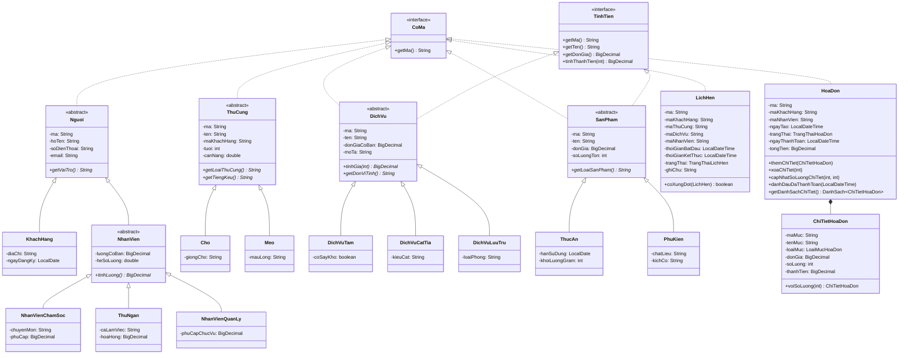

# TÀI LIỆU THIẾT KẾ HƯỚNG ĐỐI TƯỢNG (OOP DESIGN DOCUMENT)
## Đề tài: Hệ Thống Quản Lý Cửa Hàng Chăm Sóc Thú Cưng (Pet Care Store)

---

## 1. Tổng Quan Kiến Trúc Dự Án

Ứng dụng được thiết kế theo kiến trúc phân tầng rõ ràng (Layered Architecture), tuân thủ nguyên lý hướng đối tượng, tách biệt giữa giao diện hiển thị, logic nghiệp vụ, quản lý dữ liệu và cấu trúc lưu trữ:

---

## 2. Chi Tiết 4 Trụ Cột OOP Được Hiện Thực

### 2.1. Tính Đóng Gói (Encapsulation)
- Toàn bộ các trường dữ liệu (fields) của tất cả 19 lớp miền đều có phạm vi truy cập `private`.
- Các mã nhận diện thực thể (`ma`) được gán thuộc tính `final` và không có phương thức `setMa(...)`, bảo toàn tính bất biến của khóa chính và tránh việc phá vỡ các liên kết tham chiếu.
- Lớp `ChiTietHoaDon` được thiết kế bất biến hoàn toàn (`final fields`, không có setter). Khi cần thay đổi số lượng trên hóa đơn nháp, phương thức `voiSoLuong(int)` trả về một bản ghi snapshot mới với đơn giá hiệu dụng được bảo lưu.
- Lớp `HoaDon` bảo vệ danh sách chi tiết nội bộ bằng phương thức `getDanhSachChiTiet()` trả về bản sao phòng vệ (defensive copy). Mọi thao tác thêm/xóa/sửa dòng chi tiết chỉ có thể thực hiện thông qua các phương thức nghiệp vụ của `HoaDon` và đều bị từ chối nếu hóa đơn đã ở trạng thái `DA_THANH_TOAN`.
- **Phân định trách nhiệm thẩm định (Validation Responsibilities)**: Các hàm khởi tạo và phương thức setter đảm bảo tính hợp lệ cơ bản của thuộc tính (mã ID bất biến không trống, số lượng > 0, các thuộc tính cơ bản); trong khi các quy tắc ràng buộc toàn vẹn phức tạp (như số điện thoại đúng định dạng, không âm phụ cấp/lương/hoa hồng, trọng lượng dương, không trùng mã ID, khóa ngoại hợp lệ, không xung đột thời gian, kiểm tra tham chiếu và loại mục hóa đơn) được thẩm định tập trung tại tầng dịch vụ nghiệp vụ (`CuaHangService`) và phương thức thẩm định toàn diện (`kiemTraHopLeToanBo`) được kích hoạt tự động trước mỗi lần ghi đĩa (`luuDuLieu`) và sau mỗi lần nạp tệp (`napDuLieu`).

### 2.2. Tính Kế Thừa (Inheritance)
- **Nhánh Con người (`Nguoi`)**: Gom các thuộc tính chung (`ma`, `hoTen`, `soDienThoai`, `email`). `KhachHang` kế thừa và bổ sung `diaChi`, `ngayDangKy`. `NhanVien` kế thừa `Nguoi` và bổ sung `luongCoBan`, `heSoLuong`. Từ `NhanVien`, 3 lớp con phân hóa cụ thể gồm `NhanVienChamSoc`, `ThuNgan`, `NhanVienQuanLy`.
- **Nhánh Thú cưng (`ThuCung`)**: Lớp trừu tượng quản lý chung `ma`, `ten`, `maKhachHang`, `tuoi`, `canNang`. Hai lớp con `Cho` và `Meo` mở rộng với đặc tính riêng biệt: `giongCho` (đối với Chó) và `mauLong` (đối với Mèo).
- **Nhánh Dịch vụ (`DichVu`)**: Quản lý `ma`, `ten`, `donGiaCoBan`, `moTa`. Ba lớp con `DichVuTam`, `DichVuCatTia`, `DichVuLuuTru` bổ sung thông tin đặc thù (`coSayKho`, `kieuCat`, `loaiPhong`).
- **Nhánh Sản phẩm (`SanPham`)**: Quản lý `ma`, `ten`, `donGia`, `soLuongTon`. Hai lớp con `ThucAn` (bổ sung hạn sử dụng, trọng lượng gram) và `PhuKien` (bổ sung chất liệu, kích cỡ).

### 2.3. Tính Đa Hình (Polymorphism)
1. **Đa hình trong tính giá dịch vụ (`DichVu.tinhGia(int)`)**:
   - `DichVuTam`: Nếu có sấy khô, tự động cộng thêm phụ phí 20.000 VNĐ cho mỗi lần tắm.
   - `DichVuCatTia`: Nếu khách chọn tạo kiểu (`Tao kieu`), tự động tính thêm phụ phí tay nghề 50.000 VNĐ mỗi lần.
   - `DichVuLuuTru`: Nếu chọn phòng VIP, cộng thêm 100.000 VNĐ/ngày vào đơn giá lưu trú.
2. **Đa hình trong tính lương nhân viên (`NhanVien.tinhLuong()`)**:
   - `NhanVienChamSoc`: Lương cơ bản $\times$ hệ số $+$ phụ cấp chuyên môn nghề.
   - `ThuNgan`: Lương cơ bản $\times$ hệ số $+$ hoa hồng doanh số.
   - `NhanVienQuanLy`: Lương cơ bản $\times$ hệ số $+$ phụ cấp trách nhiệm chức vụ.
3. **Đa hình qua giao diện (`TinhTien`)**:
   - Cả `SanPham` và `DichVu` đều hiện thực giao diện `TinhTien`.
   - Trong quá trình tạo hóa đơn, hệ thống gọi `item.tinhThanhTien(1)` để chụp lại đơn giá hiệu dụng đơn vị (chứa đầy đủ phụ phí của dịch vụ) vào `ChiTietHoaDon`.
4. **Đa hình qua giao diện (`CoMa`)**:
   - Mọi thực thể có mã định danh đều triển khai `CoMa`.
   - Phương thức tiện ích tĩnh `timTheoMa(DanhSach<T> list, String ma)` và `sinhMaMoi(DanhSach<T> list, String prefix)` làm việc tổng quát trên bất kỳ danh sách nào có kiểu phần tử `T extends CoMa`.

### 2.4. Tính Trừu Tượng (Abstraction)
- Các lớp trừu tượng đại diện cho các khái niệm tổng quát không thể khởi tạo trực tiếp:
  - `abstract class Nguoi` với phương thức trừu tượng `public abstract String getVaiTro();`.
  - `abstract class NhanVien` với phương thức trừu tượng `public abstract BigDecimal tinhLuong();`.
  - `abstract class ThuCung` với 2 phương thức trừu tượng `getLoaiThuCung()` và `getTiengKeu()`.
  - `abstract class DichVu` với `tinhGia(int)` và `getDonViTinh()`.
  - `abstract class SanPham` với `getLoaiSanPham()`.

---

## 3. Cấu Trúc Mảng Động Tự Xây Dựng: `DanhSach<T>`

Nhằm đáp ứng yêu cầu không lạm dụng cấu trúc có sẵn của thư viện (như `ArrayList`) mà vẫn đảm bảo tính khái quát cao, lớp `DanhSach<T>` được xây dựng từ mảng thuần:
- **Bộ nhớ nền tảng**: `private Object[] phanTu;`
- **Sức chứa mặc định**: 10 phần tử.
- **Cơ chế tăng kích thước (Resize)**: Khi số lượng phần tử đạt đến giới hạn mảng, phương thức `damBaoSucChua()` sẽ nhân đôi kích thước mảng bằng `Arrays.copyOf(phanTu, phanTu.length * 2)`.
- **Thao tác xóa (`remove`)**: Dịch chuyển mảng bằng `System.arraycopy(phanTu, index + 1, phanTu, index, soLuong - index - 1)` và gán phần tử cuối về `null` để hỗ trợ cơ chế dọn rác (Garbage Collector).
- **Hỗ trợ duyệt phần tử (`Iterable<T>`)**: Lớp cài đặt interface `Iterable<T>` với một `Iterator<T>` vô danh, cho phép sử dụng cú pháp `for (T item : danhSach)` tự nhiên và dễ đọc.

---

## 4. Thiết Kế Lưu Trữ Tệp Tin & Tính Nguyên Tử Giao Dịch

1. **Format dữ liệu & Parser nghiêm ngặt**:
   - Tiêu đề tệp bắt buộc: `# PETCARE_STORE_DATA_V1`.
   - Kiểm tra số lượng cột chính xác tuyệt đối cho từng subtype.
   - Thẩm định giá trị boolean nghiêm ngặt (chỉ chấp nhận `true` hoặc `false`).
   - Thẩm định ký tự escape: chỉ chấp nhận `\\`, `\|`, `\n`, `\r`; từ chối các ký tự lạ hoặc dấu escape ở cuối dòng.
2. **Ghi tệp an toàn (Safe Atomic Move)**:
   - Dữ liệu luôn được ghi vào tệp tạm trước (`data.txt.tmp`).
   - Thay thế tệp đích bằng `StandardCopyOption.ATOMIC_MOVE`. Nếu môi trường không hỗ trợ, fallback sang `REPLACE_EXISTING`. Tuyệt đối không fallback copy cắt ngang làm hỏng tệp gốc.
3. **Tính nguyên tử giao dịch trong bộ nhớ (In-Memory Transaction Rollback)**:
   - Mọi thao tác thay đổi dữ liệu đều được bao bọc bởi phương thức `thucHienGiaoDich()`.
   - Trước khi thực hiện, hệ thống tạo bản sao lưu trạng thái (`taoBanSaoHienTai()`).
   - Nếu quá trình ghi đĩa hoặc thẩm định thất bại, hệ thống lập tức hoàn nguyên bộ nhớ (`khoiPhucBanSao()`). Nhờ đó, nếu ghi đĩa bị lỗi, trạng thái thanh toán và tồn kho không bị giữ sai lệch trong RAM.

---

## 5. Bộ Câu Hỏi & Câu Trả Lời Vấn Đáp Bảo Vệ Đồ Án (Protection Q&A)

### Câu 1: Tại sao trong dự án bạn dùng `BigDecimal` cho tiền tệ thay vì `double` hoặc `float`?
> **Trả lời:**
> Số thực dấu phẩy động (`double`/`float`) biểu diễn dữ liệu theo chuẩn IEEE 754 dưới dạng nhị phân, dẫn đến sai số làm tròn khi thực hiện các phép tính số học (ví dụ: `0.1 + 0.2 = 0.30000000000000004`). Trong ứng dụng quản lý bán hàng và dịch vụ, tiền tệ và lương nhân viên đòi hỏi độ chính xác tuyệt đối từng đơn vị đồng. Do đó, `BigDecimal` là kiểu dữ liệu chuẩn mực và bắt buộc trong các hệ thống tài chính thương mại để tránh sai lệch số dư.

### Câu 2: Làm sao hệ thống đảm bảo dịch vụ có phụ phí (sấy khô, tạo kiểu, phòng VIP) không bị mất phụ phí khi sửa số lượng trên hóa đơn?
> **Trả lời:**
> Khi thêm một dịch vụ vào hóa đơn, hệ thống gọi phương thức đa hình `item.tinhThanhTien(1)` để tính toán và lưu lại **Đơn giá hiệu dụng (Effective Unit Price)** vào đối tượng bất biến `ChiTietHoaDon`. Khi người dùng sửa số lượng trên hóa đơn nháp, phương thức `capNhatSoLuongChiTiet` sử dụng `ct.voiSoLuong(soLuongMoi)`, tính toán thành tiền mới trực tiếp từ đơn giá hiệu dụng đã snapshot ($170.000 \times 3 = 510.000$ đ) chứ không tham chiếu lại đơn giá cơ bản của danh mục, do đó bảo toàn trọn vẹn phụ phí.

### Câu 3: Làm thế nào hệ thống đảm bảo thao tác trừ tồn kho khi thanh toán hóa đơn không bị lỗi "trừ dở dang" nếu một mặt hàng bị thiếu?
> **Trả lời:**
> Phương thức `thanhToanHoaDon` trong `CuaHangService` áp dụng nguyên lý **Kiểm tra trước - Thực thi sau (All-or-Nothing / Two-phase execution)**:
> - **Pha 1**: Gom nhóm tất cả các dòng sản phẩm trên hóa đơn (sử dụng `Math.addExact` để chống tràn số) thành bản đồ tổng số lượng cần mua.
> - **Pha 2**: Duyệt qua toàn bộ bản đồ và kiểm tra với từng sản phẩm trong kho. Nếu **bất kỳ** sản phẩm nào có `soLuongTon < tongCanTru`, hệ thống lập tức dừng lại, ném ngoại lệ `ValidationException` và **không trừ bất kỳ sản phẩm nào**.
> - **Pha 3**: Chỉ khi tất cả sản phẩm đều thỏa mãn số lượng tồn, hệ thống mới thực hiện trừ kho một lần duy nhất cho từng sản phẩm và đánh dấu hóa đơn đã thanh toán.

### Câu 4: Giải thích thuật toán phát hiện xung đột lịch hẹn trong `LichHen.java` và quy tắc phân công nhân viên?
> **Trả lời:**
> Hai khoảng thời gian $[S_1, E_1)$ và $[S_2, E_2)$ giao nhau khi và chỉ khi:
> $$S_1 < E_2 \quad \text{và} \quad S_2 < E_1$$
> Nhờ biểu thức strictly less than ($<$), các khoảng thời gian liền kề (ví dụ: ca 1 kết thúc lúc 10:30, ca 2 bắt đầu lúc 10:30) không bị tính là xung đột.
> Khi khoảng thời gian giao nhau, nếu hai lịch hẹn có **cùng nhân viên chăm sóc** HOẶC **cùng thú cưng**, hệ thống sẽ báo xung đột. Hệ thống đồng thời bắt buộc nhân viên được phân công phải thuộc vai trò `NhanVienChamSoc` và tự động kiểm tra lại xung đột khi kích hoạt một lịch hẹn từ trạng thái `DA_HUY` sang `DAT_LICH`.

### Câu 5: Tại sao lớp `DanhSach<T>` cần cài đặt `implements Iterable<T>`?
> **Trả lời:**
> Việc cài đặt `Iterable<T>` cho phép đối tượng `DanhSach<T>` tương thích hoàn toàn với cú pháp vòng lặp nâng cao (Enhanced for-loop / For-each) của Java. Nhờ đó, ở tất cả các tầng giao diện và dịch vụ, mã nguồn có thể duyệt phần tử bằng `for (KhachHang kh : dsKhachHang)` vô cùng trực quan, trong sáng và chuẩn mực như các Collection chuẩn, mà vẫn giữ được bản chất cấu trúc dữ liệu mảng tự cài đặt bên trong.
